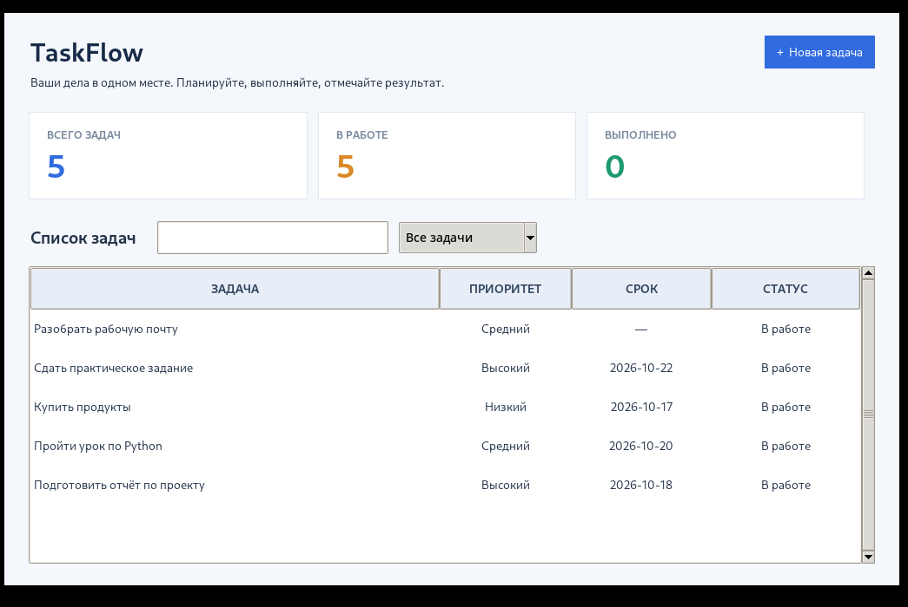
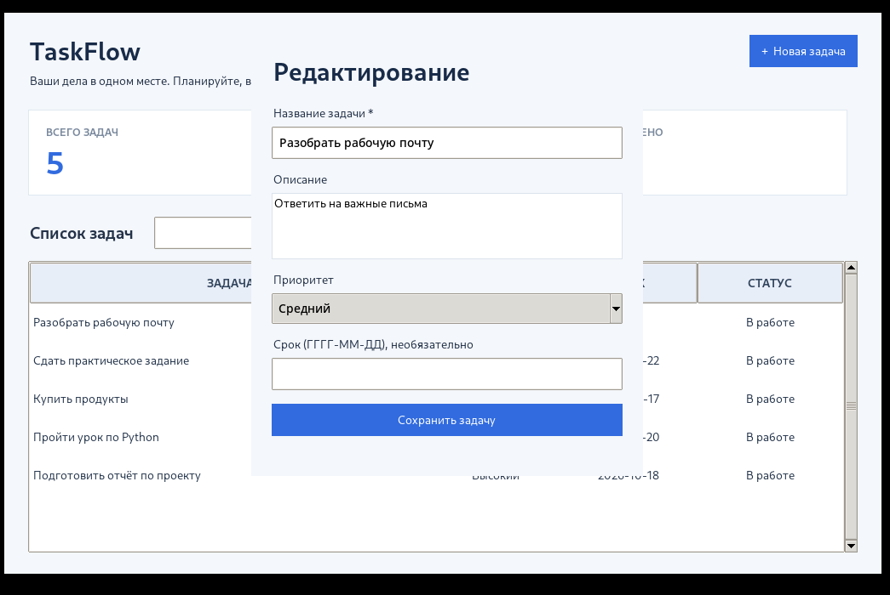
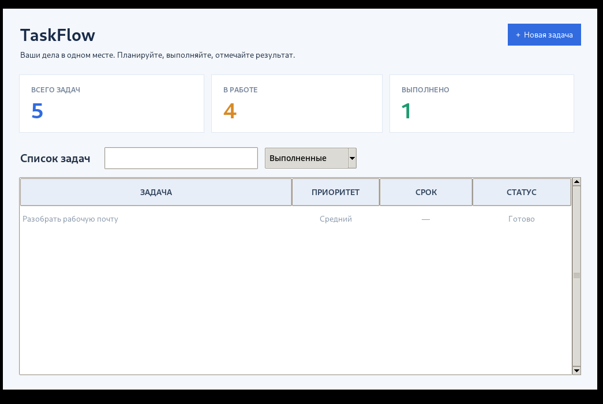

# TaskFlow

TaskFlow — приложение для управления задачами на Python. Интерфейс сделан с помощью Tkinter, для хранения данных используется SQLite.

## Возможности

- Добавление, редактирование и удаление задач
- Приоритет и срок выполнения
- Отметка выполненных задач
- Поиск и фильтрация по статусу
- Подсчёт активных и выполненных задач
- Сохранение задач после закрытия программы

## Структура проекта

- `app/models` — модель задачи и проверка данных
- `app/repositories` — интерфейс репозитория и работа с SQLite
- `app/services` — операции с задачами
- `app/ui` — главное окно и форма задачи
- `tests` — тесты
- `main.py` — запуск приложения

## Запуск

Нужен Python 3.10 или новее. Дополнительные библиотеки не требуются.

```bash
python main.py
```

Тесты:

```bash
python -m unittest discover -s tests -v
```

## Скриншоты

### Главное окно



### Редактирование задачи



### Выполненные задачи


